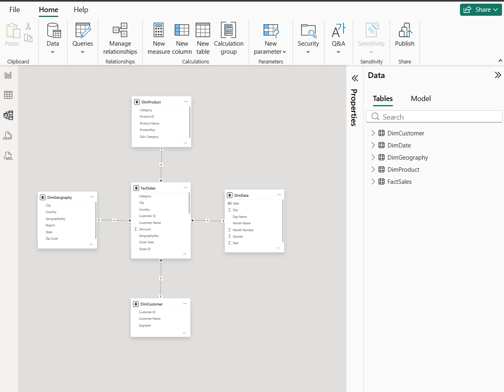
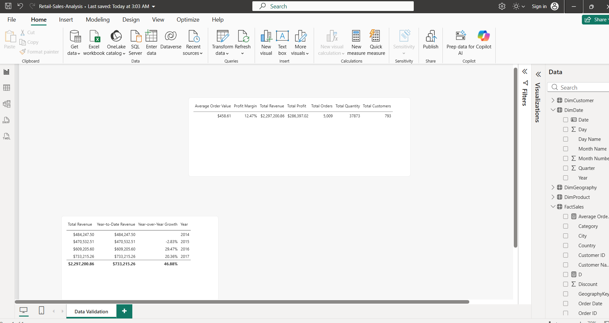

# Retail Sales & Business Intelligence Analysis

## Project Overview

This project analyzes retail sales data to identify sales trends, profitability, customer behavior, and regional performance using SQL and Power BI.

## Business Objectives

- Analyze overall sales and profitability.
- Identify top-performing products and categories.
- Evaluate regional sales performance.
- Analyze the impact of discounts on profit.
- Identify monthly and yearly sales trends.
- Identify products generating losses.

## Tools and Technologies

- Microsoft Power BI
- Power Query
- SQL Server (planned)
- DAX (planned)
- Microsoft Excel
- GitHub

## Dataset

- Source: Kaggle - Sample Superstore Dataset
- Records: 9,994
- Columns: 21
- Distinct orders: 5,009
- Distinct customers: 793
- Sales regions: 4
- Product categories: 3

[Dataset Source](https://www.kaggle.com/datasets/vivek468/superstore-dataset-final)

## Data Preparation

- Imported the dataset into Power BI.
- Inspected column quality and distribution.
- Profiled the entire dataset.
- Verified unique row identifiers.
- Corrected postal code and discount data types.
- Preserved negative profit values for analysis.

## Data Modelling and DAX

A star schema was developed in Power BI to support efficient data analysis and reporting.

### Data Model
- FactSales
- DimCustomer
- DimProduct
- DimGeography
- DimDate

### DAX Measures
- Total Revenue
- Total Profit
- Total Orders
- Total Quantity
- Profit Margin
- Average Order Value
- Total Customers
- Year-to-Date Revenue
- Year-over-Year Growth

### Data Validation

Power BI calculations were validated against SQL Server results.

| KPI | Result |
|---|---:|
| Total Revenue | $2,297,200.86 |
| Total Profit | $286,397.02 |
| Total Orders | 5,009 |
| Total Quantity | 37,873 |
| Profit Margin | 12.47% |
| Average Order Value | $458.61 |
| Total Customers | 793 |

### Star Schema

### DAX Validation

## Project Progress

- [x] Define business objectives
- [x] Download dataset
- [x] Explore dataset
- [x] Data quality inspection
- [x] Data cleaning and preparation
- [x] SQL analysis
- [x] Dimensional data modelling
- [x] DAX calculations
- [ ] Dashboard development
- [ ] Business insights and recommendations

## Author

Marie Nicole

Data Analytics Degree Student | Sheridan College

## Project Status

In Progress
